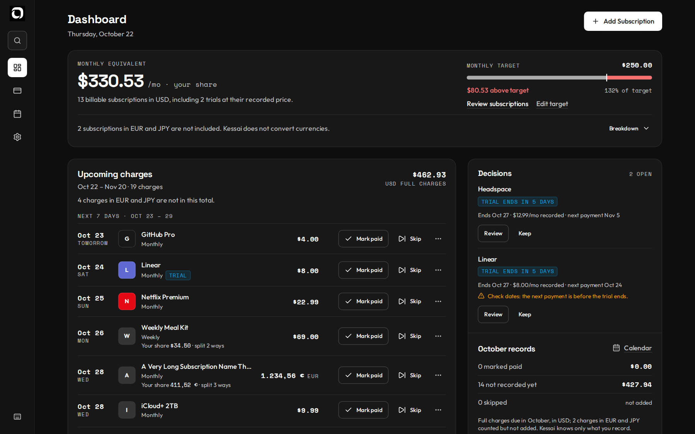
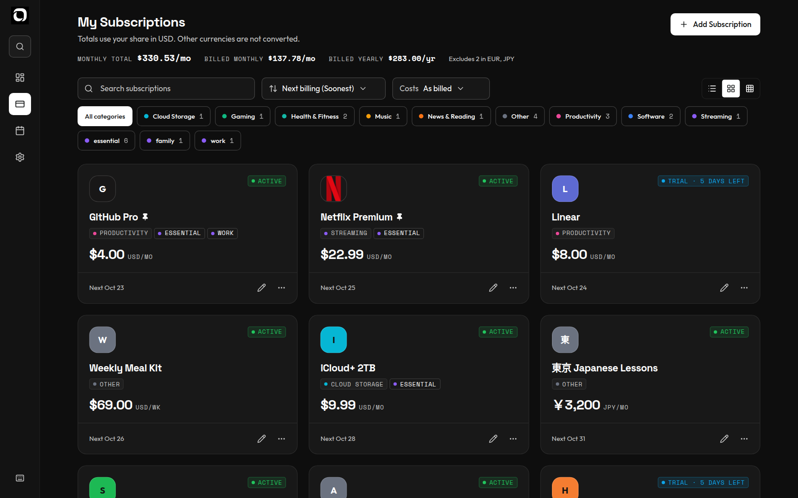
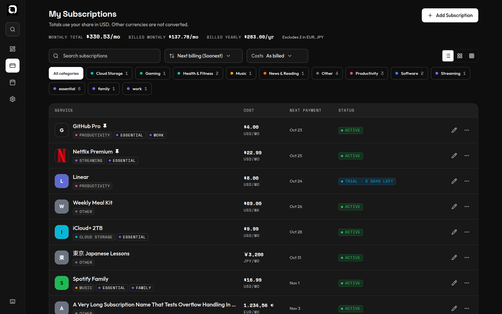
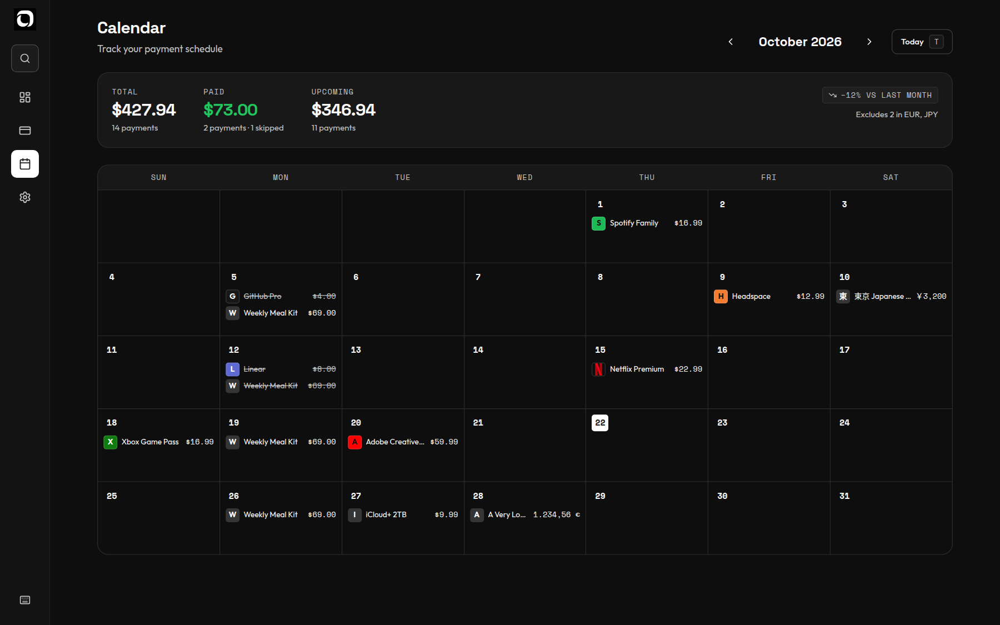

<p align="center">
  
</p>

<h1 align="center">Kessai</h1>

<p align="center">
  <strong>Know where your money flows.</strong>
  <br />
  A local-first subscription tracker. No cloud. No accounts. Just you and your data.
</p>

<p align="center">
  
  
  
  
</p>

<br />

<p align="center">
  
</p>

---

## Features

- **Dashboard** -- A renewal ledger: every charge in the next 30 days from the calendar projection (weekly plans once per due date), with Mark paid and Skip on each row, the full charge plus "your share" on shared plans, and a subtotal that names the currencies it leaves out. Beside it, Decisions (trials ending within 7 days, grace periods, recorded price increases) and a short "Worth reviewing" list. One summary states the monthly equivalent of your share in the display currency against an optional monthly target, with the exact variance
- **Subscriptions** -- Grid, responsive list, and bento views. Search, sort, filter by category or tags, pin favorites, and reactivate cancelled subscriptions
- **Custom logos** -- Upload PNG, JPEG, WebP, or GIF (5 MiB, 4096 px per side); stored as WebP. Desktop and browser. SVG excluded
- **Calendar** -- Core-computed recurring occurrences, including every weekly renewal and recorded payments for cancelled subscriptions. Amounts are the full recorded or projected charges in the display currency, with other currencies listed as excluded. Mark as paid or skip; a paid or skipped outcome on the current due date advances the schedule atomically to the next unsettled period, while retries, historical payments, payments recorded ahead of time, and manual edits do not
- **Global Search** -- `Cmd/Ctrl+K` to find subscriptions from any page; `N` opens the subscription editor
- **Multi-Currency** -- Currency-specific minor units and locale formatting plus billing-cycle cost normalization (daily/weekly/monthly/yearly). No live FX rates or automatic conversion
- **Desktop Reminders** -- Configurable renewal notifications while Kessai is running, with missed reminder windows consolidated per renewal. System tray badge
- **Lifecycle Tracking** -- Trials with a required end date, cancellations with reasons, paused subscriptions, and grace periods. Zero-cost subscriptions are allowed
- **Data Portability** -- JSON export/import, CSV/bank statement import, diagnostic logs. Restore validates and normalizes the whole backup before writing; invalid records reject the entire restore
- **Private Web Access via Tailscale** -- Optional desktop-managed loopback server for private browser access from your tailnet; browser cookies contain a per-server random session token, never the access key
- **Web + CLI + MCP** -- Browser mode, terminal CLI, AI assistant integration over the same shared core
- **Dark/Light Themes** -- Shared UI primitives, visible focus, responsive touch controls, and reduced motion from either the OS preference or app setting. Product and visual rules live in [PRODUCT.md](PRODUCT.md) and [DESIGN.md](DESIGN.md)

---

## Screenshots

<p align="center">
  
  
</p>

<p align="center">
  <em>Grid and list views with cost totals, category/tag badges, and pin controls</em>
</p>

<p align="center">
  
</p>

<p align="center">
  <em>Renewal calendar with paid, pending, and upcoming payments across the month</em>
</p>

---

## Install

### Recommended: Download a Prebuilt Release

Most users should install a prebuilt binary from [Releases](https://github.com/Artificial-Source/Kessai/releases). You do **not** need Rust for this.

| Platform          | What to download | Install                                                     |
| ----------------- | ---------------- | ----------------------------------------------------------- |
| **Ubuntu/Debian** | `.deb`           | `sudo dpkg -i kessai_*.deb`                                 |
| **Fedora/RHEL**   | `.rpm`           | `sudo rpm -i kessai-*.rpm`                                  |
| **Any Linux**     | `.AppImage`      | `chmod +x Kessai-*.AppImage && ./Kessai-*.AppImage`         |
| **macOS**         | `.dmg`           | Open the disk image, then drag `Kessai.app` to Applications |
| **Windows**       | `.exe`           | Run the installer                                           |

**macOS note:** release updater bundles are signed, but Apple Developer ID code signing and notarization are not configured yet. If Gatekeeper blocks the app, use Finder → right-click `Kessai.app` → **Open**, then confirm. See [Install](docs/how-to/install.md) and [Troubleshoot](docs/how-to/troubleshoot.md#installed-desktop-app-wont-start-or-open).

Example Linux flow after downloading a release asset:

```bash
cd ~/Downloads
sudo dpkg -i kessai_*.deb
```

If `dpkg` reports missing dependencies, run:

```bash
sudo apt-get install -f
```

### Build from Source (Developers)

Building from source is slower because it compiles the Rust backend and Tauri app.

Prerequisites:

- Node.js 22+
- pnpm 10+
- Rust stable toolchain
- Tauri system dependencies for your OS

Ubuntu/Debian system packages:

```bash
sudo apt-get update
sudo apt-get install -y libwebkit2gtk-4.1-dev libgtk-3-dev libayatana-appindicator3-dev librsvg2-dev patchelf
```

Build:

```bash
git clone https://github.com/Artificial-Source/Kessai.git
cd Kessai
pnpm install --reporter=silent
pnpm tauri build
```

For local development instead of a production build:

```bash
pnpm start
```

The dev desktop app launches as `Kessai Dev` with a separate app identity and data directory, so it does not collide with an installed production `Kessai` app.

---

## CLI & MCP

`kessai-mcp` is a full CLI and MCP server over the same local database and business layer as the desktop app. It never contacts banks or providers; marking a subscription cancelled changes only its local record.

### One-command install

macOS / Linux:

```bash
curl -fsSL https://raw.githubusercontent.com/Artificial-Source/Kessai/main/install-cli.sh | sh
```

Windows (PowerShell):

```powershell
irm https://raw.githubusercontent.com/Artificial-Source/Kessai/main/install-cli.ps1 | iex
```

Options: `--version`/`-Version`, `--dry-run`/`-DryRun`, `--bin-dir`/`-BinDir`, `--mcp-config`/`-McpConfig` (runs `setup --output` after install). Installers need no admin rights, verify adjacent `.sha256` sidecars, and enforce a strict archive layout. Supported targets: Linux x64, macOS x64/arm64, Windows x64 (no Linux arm64 yet).

### Manual download

Prebuilt archives are attached to each [Release](https://github.com/Artificial-Source/Kessai/releases), each with a sibling `.sha256`, plus `LICENSE` and an offline `skills/kessai` copy:

| Platform                  | What to download                                       | Run              |
| ------------------------- | ------------------------------------------------------ | ---------------- |
| **Linux**                 | `kessai-mcp-<version>-x86_64-unknown-linux-gnu.tar.gz` | `./kessai-mcp`   |
| **macOS (Intel)**         | `kessai-mcp-<version>-x86_64-apple-darwin.tar.gz`      | `./kessai-mcp`   |
| **macOS (Apple Silicon)** | `kessai-mcp-<version>-aarch64-apple-darwin.tar.gz`     | `./kessai-mcp`   |
| **Windows**               | `kessai-mcp-<version>-x86_64-pc-windows-msvc.zip`      | `kessai-mcp.exe` |

Or build from source: `cargo build --release -p kessai-mcp`.

### Quick CLI

```bash
kessai-mcp info --json
kessai-mcp --json subscriptions list --query Netflix
kessai-mcp --json subscriptions create --name Netflix --amount 15.99 --billing-cycle monthly --next-payment-date 2026-10-25
kessai-mcp --json payments record <ID> --status paid
kessai-mcp --json calendar month 2026-10
kessai-mcp --json subscriptions delete <ID> --dry-run
kessai-mcp --json backup export backup.json
kessai-mcp --json backup import backup.json --mode merge --dry-run
```

Use IDs from list/create results. `--json` emits the result DTO directly, the same shape as MCP structured content; failures leave stdout empty and write an error object to stderr. Lists return `items`, `total`, and `next_cursor`: keep paging until the cursor is null. Discover installed flags and output schemas with `kessai-mcp schema subscriptions update`. Full contract: [MCP and CLI](docs/reference/mcp-cli.md).

### MCP and agent skill

```bash
kessai-mcp setup --output .mcp.json --dry-run   # review the proposed merge
kessai-mcp setup --output .mcp.json            # preserve other servers; back up existing file
kessai-mcp serve                              # explicit stdio server
```

Tools use one predictable grammar (`subscriptions_list`, `subscriptions_update`, `payments_record`, `calendar_month`) with typed inputs, declared success schemas, and actionable errors. `serve --read-only` hides and rejects all write tools; `setup --read-only` records that policy in client configuration. Deletes and overwrite/replace imports use preview → user approval → confirmation. Bare `kessai-mcp` prints help and exits 2. Optional `serve --http` is token-protected, loopback-only Streamable HTTP for local agents — prefer stdio. See [How to use the Kessai MCP server](docs/how-to/use-mcp-server.md).

Agent skill (MCP-first, JSON CLI fallback):

```bash
npx skills add Artificial-Source/Kessai --skill kessai
```

## Hosted and standalone web access

Kessai never installs, runs, or configures the Tailscale daemon. Choose the mode that matches how you want to reach the web UI:

| Mode                                               | When to use it                                                      | Authorization                                                         |
| -------------------------------------------------- | ------------------------------------------------------------------- | --------------------------------------------------------------------- |
| **Standalone (default)**                           | Local development and same-machine browser use                      | None. Binds `127.0.0.1` by default; unauthenticated                   |
| **Standalone Tailscale-only** (`--tailscale-only`) | Trusted headless host (Docker, mini PC) behind host Tailscale Serve | Tailscale identity only — no second Kessai login                      |
| **Desktop Private Web Access**                     | Reach the desktop app's data from other devices on your tailnet     | Tailscale identity **plus** an access-key-bootstrapped session cookie |

```bash
cargo run -p kessai-web -- --port 3000   # default standalone: 127.0.0.1, no auth
```

On a non-loopback standalone listener, accepted request hosts are the bound IP literal and explicit `--allowed-host <hostname-or-IP>` entries (repeatable, or comma-separated `KESSAI_WEB_ALLOWED_HOSTS`). A wildcard bind such as `--host 0.0.0.0` does not accept arbitrary hosts. This is a browser boundary, not authentication; isolate the listener or use an authenticated reverse proxy. See [Run locally](docs/how-to/run-locally.md#run-web-server-directly).

The web API returns `400` for domain validation errors, `404` for missing records, and `409` for conflicts, with the same `{ "error": "…" }` envelope. See the [Web API reference](docs/reference/web-api.md).

Browser mode supports custom-logo uploads: PNG, JPEG, WebP, and GIF (5 MiB, 4096 px per side maximum; stored as WebP; SVG excluded).

### How identity works (short version)

A remote browser cannot choose its Tailscale identity. Tailscale Serve strips caller-supplied identity headers and injects a verified `Tailscale-User-Login`. Kessai then requires one nonempty login, a valid `.ts.net` authority, HTTPS semantics, and an exact matching HTTPS `Origin` on mutations. Browser Settings reports that validated request context via `/api/access/status`.

A program already on the host that can reach the loopback backend can imitate those internal headers. That is an accepted **host-trust** boundary, not a remote bypass: other PCs, uninvited tailnet users, and internet visitors cannot do this. Full detail: [How Tailscale identity reaches Kessai](docs/explanation/security-and-privacy.md#how-tailscale-identity-reaches-kessai) and the [Tailscale Serve identity-header docs](https://tailscale.com/docs/features/tailscale-serve#identity-headers).

### Tailscale-only standalone hosting

A headless `kessai-web` host can authorize requests using Tailscale Serve identity alone—no nginx Basic Auth or second Kessai login:

```bash
kessai-web --tailscale-only --host 127.0.0.1 --port 8482 --dist-dir dist
tailscale serve --bg http://127.0.0.1:8482
```

Do not use Funnel. Keep the listener reachable only from host loopback.

For a container whose internal listener must be `0.0.0.0`, explicitly enable proxy trust but publish it on host loopback only. Persist `/data` so the database, sibling `logos/`, and `logs/` survive container recreation. There is no official Kessai image:

```bash
docker run --rm \
  -p 127.0.0.1:8482:3000 \
  -v kessai-data:/data \
  <your-kessai-image> \
  kessai-web --tailscale-only --trust-tailscale-proxy \
    --host 0.0.0.0 --port 3000 \
    --db-path /data/kessai.db \
    --dist-dir dist
tailscale serve --bg http://127.0.0.1:8482
```

Your image must make `/data` writable. Health checks should use the no-data path `GET` or `HEAD` `/__kessai/health` (`204`). See [Run Kessai locally](docs/how-to/run-locally.md#run-tailscale-only-standalone-hosting) for the full trust boundary.

### Private Web Access via Tailscale

In the desktop app, open **Settings → Private Web Access**, choose a local port (default `3000`), enable it, and apply the change. Kessai starts its server only on `127.0.0.1`. It does not install, run, configure, or probe the Tailscale daemon, but it does recognize validated Serve requests. Then run the exact command shown in Settings, for example:

```bash
tailscale serve --bg http://127.0.0.1:3000
```

Copy the **Access key** shown in Settings, then open the HTTPS `.ts.net` URL printed by Tailscale and paste the key into Kessai's access page. The browser receives a host-only, HttpOnly session cookie containing a random token, never the persistent key. Restarting the private server invalidates that session and asks for the key again. This key prompt is an extra local gate, not an account or full login system. Disabling and re-enabling Private Web Access also rotates the key and revokes existing sessions.

Your tailnet policy controls who can reach the access page. Keep Kessai running (closing its window to the tray is fine); use **Quit** to stop Kessai's server. Tailscale Serve configuration remains until `tailscale serve reset`. Private Web Access rejects Tailscale Funnel. Full backup restore/import is blocked while Private Web Access is active; export remains available. For prerequisites and troubleshooting, see [Configure Kessai](docs/how-to/configure.md#configure-private-web-access-via-tailscale).

---

## Development

```bash
pnpm start               # Start Kessai Dev desktop app
pnpm check               # Lint + typecheck + format
pnpm test:run            # Frontend tests
cargo test --locked --workspace   # Rust tests
```

**Stack:** Tauri 2 (Rust) + React 19 + TypeScript + Vite 7 + Tailwind CSS 4 + shadcn/ui-style primitives + Zustand + SQLite

**Structure:**

```
src/           React frontend (components, pages, stores, hooks, types)
src-tauri/     Rust backend + Tauri commands
crates/        kessai-core (SQLite + business logic), kessai-web (Axum server), kessai-mcp (CLI + MCP server)
e2e/           Playwright E2E tests
```

---

## Data & Privacy

Subscription and payment data stay on your device by default, in plain SQLite you can inspect, back up, or migrate. Optional logo fetches and update checks make network requests; enabling web access exposes the same local data through that server.

| Platform | Location                                           |
| -------- | -------------------------------------------------- |
| Linux    | `${XDG_DATA_HOME:-~/.local/share}/com.asf.kessai/` |
| macOS    | `~/Library/Application Support/com.asf.kessai/`    |
| Windows  | `%APPDATA%/com.asf.kessai/`                        |

Structured logs in the app data `logs/` directory for debugging. Frontend logs downloadable from Settings.

Desktop renderer filesystem access is limited to the write-text-file permission used for exports and the dialog plugin; it has no general app-data directory read/write grant. Native commands perform database and logo operations. See [Security and privacy](docs/explanation/security-and-privacy.md).

## Documentation

Browse the full docs set in [`docs/index.md`](./docs/index.md) for tutorials, task guides, reference pages, and architecture notes.

---

## License

[MIT](./LICENSE) -- Built by [Artificial Source](https://github.com/Artificial-Source)
